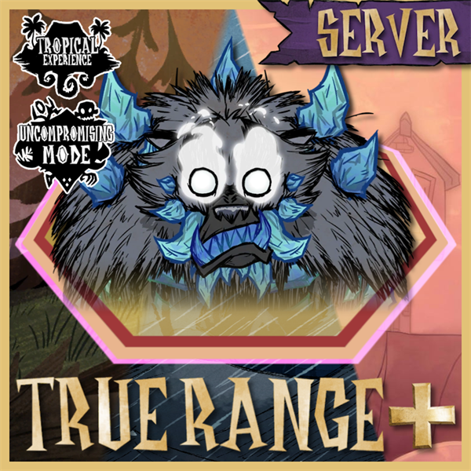

# True Range+



A Don't Starve Together mod that draws where a monster's attack will really land, before it lands - plus the tools used to build and test it.

When a monster winds up, the area its move will hit is drawn on the ground. The shapes aren't guessed: each move is worked out offline by running the game's own code, and accuracy is measured against real games on both the host and a lagging client.

Works with the base game, [Uncompromising Mode](https://steamcommunity.com/sharedfiles/filedetails/?id=3193922031) and [Tropical Experience](https://steamcommunity.com/sharedfiles/filedetails/?id=1505270912).

## Get the mod

- [True Range+ on the Steam Workshop](https://steamcommunity.com/sharedfiles/filedetails/?id=3817047528) - for servers (players get it when they join)
- [True Range+ (Client)](https://steamcommunity.com/sharedfiles/filedetails/?id=3819645697) - just for you, on servers that don't have the mod

## What you see

| Colour | Means |
|---|---|
| Faint red | an attack coming later |
| Red | soon |
| Yellow | about to strike |
| Deep red | striking now |
| Purple | only freezes you or puts you to sleep |
| Green ring | your own weapon's reach |
| Yellow ring | how near a monster comes before it starts attacking you |
| White ring | your body - the part attacks have to reach |

On a server (caves, or joining a friend) the warnings take the game's Lag Compensation into account, so they match where the server has you.

## Settings

Press **O** in game (the key can be changed):

- which monsters are drawn, and at most how many at once
- your reach, friends' rings and reach, Abigail's reach, the yellow ring
- opacity of each part - attacks, outlines, your rings, other rings - from 0% to 100%
- rings drawn solid or dotted, and how close the dots

**Ctrl + O** turns everything off or on at once.

## What's in this repo

| Folder | What it is |
|---|---|
| `true_range/` | The mod itself - this folder is what gets uploaded to the Workshop |
| `true_range_workshop/` | Tools, tests, docs and patch notes |
| `true_range_workshop/tools/` | Building each move's data from the game's scripts (`sim_moves.lua`), install, benches |
| `true_range_workshop/tests/` | Unit tests, replays of real game logs against the mod's drawing |
| `true_range_workshop/docs/` | Developer docs - start at [docs/README.md](true_range_workshop/docs/README.md) |
| `tr_testbench/` | Local test mod (server side): spawns bosses and a stand-in player for benches - never uploaded |
| `tr_lagjoin/` | Local test mod (client side): joins a bench server by itself and records every drawn frame - never uploaded |

## Developing

You need Don't Starve Together, [LuaJIT 2.1](https://luajit.org) on your PATH and Windows PowerShell 5.1. See [docs/02-setup.md](true_range_workshop/docs/02-setup.md), then [06 Workflow](true_range_workshop/docs/06-workflow.md) before your first change.

- **The game's path is hard-coded** for the original machine (`D:\Games Manager\...`). Search `tools\` and `tests\` for `Games Manager` and change it to yours. Your Klei account folder (`Documents\Klei\DoNotStarveTogether\<number>`) is found by itself; set `DST_KLEI_ACCOUNT` if you have several.
- The game's own scripts are not in the repo: they're unpacked from your game into `true_range_workshop/tests/work/` (see the setup doc).
- Never commit a `cluster_token.txt` - `.gitignore` keeps them out.

Quick checks:

```powershell
luajit true_range_workshop/tests/test_sim.lua true_range      # unit tests
powershell -File true_range_workshop/tools/install.ps1         # copy the mod into the game's mods folder
```

What's still open: [docs/08-status.md](true_range_workshop/docs/08-status.md). What changed in each version: `true_range_workshop/patch_notes_<version>.txt`.

## License

[MIT](LICENSE) - use it, change it, build on it; keep the copyright notice.
